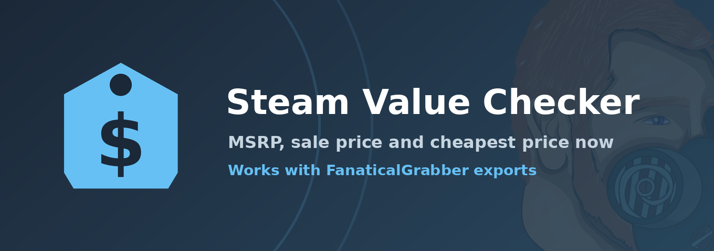

<div align="center">



# Steam Value Checker

**Find out what your game library is worth, and how much you saved.**


</div>

---

## What it does

Give the bot a list of game titles, or upload an export from the [FanaticalGrabber](https://jacob-lucado.github.io/FanaticalGrabber/) browser extension, and it sends back:

| Column | Meaning |
| --- | --- |
| **MSRP** | The regular price |
| **Steam** | The current Steam price |
| **Cheapest** | The lowest current price across tracked stores, with the store name |
| **All-time low** | The lowest price ever recorded (shown in the totals) |

Tell it what you paid and it works out how much you saved against each one.

Prices come from [IsThereAnyDeal](https://isthereanydeal.com).

> The bot **never needs game keys, Steam logins or cookies.** Anything that looks like a key is thrown away before any lookup. Replies are visible only to the person who ran the command.

## Commands

### `/games value`

| Option | What it does |
| --- | --- |
| `titles` | Game titles separated by `;` or new lines |
| `file` | A FanaticalGrabber export: `.csv`, `.json`, `.txt` or `.md`. Only the game titles are read |
| `paid` | What you paid in total, to see savings and cost per game |
| `region` | US, UK, Germany, Canada, Australia or Brazil prices |
| `stores` | Count every tracked store (including key sites), or major stores only, for "cheapest now" |
| `sort` | As entered, name, MSRP or cheapest price |

Examples:

```
/value titles:Hades; Celeste; Hollow Knight
/value file:FanaticalGrabber_2026-10-26.csv paid:25 region:GB
```

### Wishlist and sale alerts

Import your Steam wishlist (or add games by hand) and the bot tells you when something goes on sale.

| Command | What it does |
| --- | --- |
| `/me wishlist import profile:` | Reads your **public** Steam wishlist from a profile link, custom name or SteamID64. No login. Run it again to sync new games (and drop ones you removed on Steam) |
| `/me wishlist add title:` | Adds one game by title, with an optional alert rule |
| `/me wishlist remove game:` | Removes a game (autocompletes from your list) |
| `/me wishlist view` | Your list with current prices, sales first |
| `/me wishlist alert type:` | Sets when you are alerted, for one game or all: any sale, a % off or more, a price or lower, or an all-time low |
| `/me wishlist check game:` | Is it a good deal right now? Price, 3-month, 1-year and all-time lows, a plain verdict, and a buy now or wait recommendation from a year of price history and the next Steam sale |
| `/alerts delivery` | DM (default) or the server alert channel |
| `/alerts quiethours`, `digest`, `bundles`, `freegames`, `share`, `history` | Hold alerts overnight (with your time zone), a weekly sales digest, bundle and giveaway alerts, opt in to server group alerts and the leaderboard, and your recent alerts |
| `/alerts codes` / `promos` | DM when a new game code drops (all games or only some) or when NVIDIA, SteelSeries or a game's news mentions a giveaway or code. Only new ones from when you turn it on; also on the dashboard's Alerts page |
| `/alerts freegames enabled:` | Get told when any game is free to claim. One message per store; several free games from the same store come with a **Claim all** button, a single game with **Claim game** |
| `/games watch title:` | Watch one game for a price drop without adding it to your wishlist. Removed after the alert, or after 30 days |
| `/games sales` | Upcoming Steam sales and festivals with countdowns (dates in `src/salescal.js`, update when Valve announces new ones) |
| `/server promos list\|add\|end\|channel\|ping\|news` | Promo drops such as SteelSeries or NVIDIA giveaways. Managers add a code or link (also on the dashboard under Servers, Promo drops) and it is posted once, then grayed out when it ends. `news` also posts giveaway and code news from the NVIDIA and SteelSeries blogs and the Steam news of games like Dead by Daylight (RSS, `src/drops.js`) |
| `/server stream` | `link` / `unlink` connect your Twitch, Kick or YouTube channel so the bot posts and closes the go-live message by itself (`src/streamwatch.js`; Twitch needs `TWITCH_CLIENT_ID` and `TWITCH_CLIENT_SECRET`, Kick needs `KICK_CLIENT_ID` and `KICK_CLIENT_SECRET`, YouTube is a best-effort check of the channel's live page), `live` posts a go-live message by hand (with a ping for people who opted in) in the live channel, `end`, `ping` (opt in or out), `list`, `setup` (managers: streamer role, live channel, ping role). Also the dashboard's Streams page. Community setup makes the Streamer role, #stream-live and the Stream pings role (`src/stream*.js`) |
| `/player` | Link button that opens the music studio for this server (also a "Big player" button on the now-playing post) |
| `/music` / `/play` | SoundCloud in a voice channel: play a track, search or paste a playlist link, queue, skip with votes, loop, seek, volume, saved playlists, DJ role and limits (`/music settings`). Also the dashboard's Music page. Uses yt-dlp and ffmpeg (both installed by the Dockerfile; `src/music*.js`) |
| `/games codes latest\|channel\|games\|ping` | Limited-time game codes (Borderlands SHiFT, Genshin Impact, Honkai: Star Rail, Zenless Zone Zero). `latest` lists working codes. Managers pick the channel, the games and a role to ping; the same settings are on the dashboard under Servers, Game codes. Sources: a community SHiFT list on GitHub and two HoYoverse code lists (`api.ennead.cc`, `hoyo-codes.seria.moe`), checked every 20 minutes (`src/codesource.js`) |
| `/me publicpage enabled: name:` | A public, shareable page of your wishlist and best prices at `#/u/name`. Shows only game names, art and prices |
| `/bot status` | Live health checks, uptime and incidents (the same data as the dashboard Status page) |
| First-run wizard | `public/app.js` (`startTour`): a nine-part tour then a six-step setup in one dialog. Skipping the tour asks to confirm and still runs setup. Opens when `me.tour` is true (not yet welcomed); progress is kept in localStorage (`svc.wizard`) so the Steam sign-in redirect resumes at the same step. **Take the tour** on My page replays it |
| Playtests page | `src/playboard.js` + `GET /api/playtests`: merges Steam news posts for the member's wishlist and library (classified by `classifyPost`) with the merged site list from `src/playsources.js`, flags wishlist and owned games. The page (`playtestsView` in `public/app.js`) re-fetches every 5 minutes while visible and marks new items; the sources cache for 50 and 30 minutes |
| Command menus | `/games menu`, `/me menu`, `/server menu`, `/manage menu`, `/bot menu`, `/mod menu` open a private panel with live status per area: pick a command, fill its options in with dropdowns, pickers and a small form, then Run (`src/hubpanel.js`, `src/panelglance.js`). `/music` has it behind the player's All commands button. `/alerts status` is a full settings panel. The dashboard Help page lists the same menus. |
| Public profiles | A customizable page at `/u/<slug>`: themes, accent, background, layout, banner, bio, links, favorite games, per-section visibility (public, server only, hidden), a profile song button (YouTube, SoundCloud, Spotify embeds or a live radio stream). Edited under Account, My profile, or with `/me profile`. Visitors can report; admins can hide (`src/profilepage.js`, `src/profilestore.js`, `src/profilehandlers.js`). |
| AI companion | Optional. Works with Anthropic (default), OpenAI, Google Gemini, OpenRouter, Groq, Mistral, xAI and DeepSeek (`src/aiproviders.js`, fixed addresses only). The bot's key is `AI_API_KEY` (or `ANTHROPIC_API_KEY`), the service `AI_PROVIDER`, the model `AI_MODEL`; servers can bring their own key and pick their own service and model. With no key it runs in lite mode (`src/ailite.js`): the bot answers prices, free games, wishlist, library and play-next questions itself and says the full AI is coming soon; nothing leaves the bot. Set `ANTHROPIC_API_KEY` (and optionally `AI_MODEL`, `AI_DAILY_CAP`). Server managers opt in with `/manage community ai` or the Community page; "Hey AI ..." needs the Message Content intent switched on in the Developer Portal, mentions always work. It answers with tools over the bot's own data (`src/aitools.js`: prices, free games, the asker's wishlist and library, server leaderboard, add to wishlist). Per-server daily limit, per-person wait; the owner tunes everything live under Admin, AI companion and Bot settings (`src/runtimecfg.js`). Questions go to Anthropic. |
| Main server | The bot owner's own (support) server. It is whichever single server the bot was first in, or `MAIN_GUILD_ID`. The dashboard's Support server button links to a permanent invite for it (made once; or set `SUPPORT_SERVER_URL`). The AI companion is never limited there. AI Plus (a work-in-progress subscription) is a per-server switch under Admin, AI companion. |
| Languages | Twelve: English, Spanish, French, German, Portuguese, Italian, Russian, Polish, Turkish, Japanese, Korean, Chinese. `/language` (and `/alerts language`) sets the bot's buttons and alerts; the dashboard has a 🌐 picker that saves to the same account setting. Dashboard phrases live in `src/dashi18n.js` (the server cuts out one language at a time and serves it as `/i18n-<code>.js`, so a reader downloads only their own; `public/i18n.js` is the small lookup), bot labels and slash command descriptions in `src/i18n.js` (Discord shows descriptions by each person's own app language). Text not in a list stays English. |
| Now playing | `src/nowplaying.js`: Steam current-game lookup for members who opted in (`/server nowplaying join:true`, share on, Steam linked), a 60s cache, `GET /api/nowplaying`, and a 3 minute squad-up post in the squad channel (4 hour gap per game). Needs `STEAM_API_KEY`. |
| Indie showcase in community setup | `src/community.js` builds #indie-spotlight, #indie-games and the Indie pings and Indie dev roles; `src/indiespotlight.js` posts the Wednesday pick to every server with an indie channel set (dashboard: Ping roles) |
| Indie dev panel | `public/devpanel.js` + `/api/indie/dev*` routes in `src/dashboard/server.js`: an approved indie game grants the Verified IndieDev role (`community.indie_dev_role`, created by community setup) and a welcome DM. The panel covers stats, key request approve/decline (bulk, CSV), a key pool (`indie_keys`) that is DMed on approval, and news posts |
| Fortnite page | `public/fortnite.js` + `src/fortnite.js` (`/api/fortnite/*`, public): the item shop in Fortnite's own layout (sections, sized tiles, rarity colors, V-Bucks), news, new cosmetics, map and cosmetic search from the free fortnite-api.com, cached 10 to 60 minutes with the last good copy served if it goes down. Player stats appear only when the `FORTNITE_API_KEY` secret is set (a free key from fortnite-api.com) |
| LucadoOS desktop (site theme) | `public/lucadoos.js` + `public/lucadoos.css`: an opt-in desktop (🖥️ in the header; `?os=1` / `?os=0`) where each site page opens in a window. Each window runs its own copy of the site (`window.SVC_SITE({ root, path, state, onNavigate })` in `app.js`) with its own address and no header or footer; the desktop shares its settings and account with them. Setting localStorage `lucado-frames` to `1` falls back to same-origin frames (the server allows framing only for same-origin `Sec-Fetch-Dest: iframe` requests) |
| Overlay studio | `#/overlays` is the one place for every OBS overlay, as tabs: goal bars, server stats and timers (`src/overlays.js`, `stream_overlays` table, `svcx_` tokens, `GET/POST /api/overlays`, public `GET /api/overlay/data` and the live `GET /api/overlay/stream`, pages `ov.html/ov.js/ov.css`), the now-playing card, the giveaway overlay and the deals and cards overlay. 12 overlays each, 24 for supporters. |
| Supporter passes | One-time Square checkout (`src/square.js`, `src/supporters.js`): `POST /api/supporter/checkout`, signed webhook `POST /api/square/webhook` for `payment.updated`, `refund.created` and `refund.updated`. Gifts, a Founding supporter mark for the first 50 paid passes, an opt-in wall, a Supporter role in the main server, three profile themes, a profile glow, 24 overlays, your own color on your price-alert cards and 25% XP. Edit everything under Admin, Supporters. Env: `SQUARE_ACCESS_TOKEN`, `SQUARE_LOCATION_ID`, `SQUARE_WEBHOOK_SIGNATURE_KEY`, optional `SQUARE_WEBHOOK_URL` and `SQUARE_ENV=sandbox`. |
| `/bot supporter` | Your supporter pass: whether it is active and until when, the founding mark, your wall name and what the pass gives, with a link to the tip page (`handleSupporter`, `supporterEmbed`) |
| Admin panel (LucadoOS) | Opens from the Admin button (`/admin`, or `ADMIN_URL`). On a wide screen it is a desktop with windows, a taskbar and a Start menu; the owner adds admin users (password or Discord) and picks what each may change. The Staff chat holds team channels, DMs, and every support ticket, bug report and feature request. Each person picks their own look, wallpaper and neon waves under Personalize. Needs-attention list on the overview, profile page moderation, Square activity, supporters (full edit and CSV), data requests and the audit log. The old in-dashboard admin page is gone. |
| Server rivalries and deal story cards | `src/rivalry.js` pairs servers with the weekly digest on once a month. `src/dealstory.js` draws the tall "Share this deal" picture from a sale alert. |
| Streamer hub and deals overlay | `#/streamer` page (the overlay itself now lives in the Overlay studio); `src/streamcard.js` (`stream_card` table, `svcd_` token per person), `GET/POST /api/streamcard`, public `GET /api/streamcard/data?token=`, OBS page `/streamcard` (`public/streamcard.*`). |
| Game club | `src/gameclub.js` (`game_club` table): `/server club pick/status/channel/off`, `GET/POST /api/club`, weekly no-ping card in the club channel from the hourly job, month-over note once. Progress comes from the library of members who share. |
| Stream chat commands and giveaways | `GET /api/streamcard/text?token=&kind=` (plain text for chat bots), `/server stream chat`, `src/streamgiveaway.js` (`/server stream giveaway`, `POST /api/streams/giveaway`; drawn from `createStreams({ onEnd })`). The overlay's Playing now card uses the Steam current-game lookup. |
| Extension extras (2.9) | `src/extapi.js`; the link-code routes `GET /api/grabber/game` (adds `playtest`, `social`, `overlay`), `POST /api/grabber/wishlist`, `POST /api/grabber/spotlight` (10 minute overlay card), `GET /api/grabber/badge`. Counts only for server members; everything needs the member's link code. |
| Playtest channel refresh | `refreshPlaytestChannel` in `src/playtests.js`, from `/manage community playtests [count]` and `POST /api/community/playtests`. Posts the newest listed items (default 8, max 15) oldest first with no role ping, marks everything seen so the regular job skips it. Needs a playtest channel; 60 second cooldown |
| Playtest sources | `src/playsources.js`: Alpha Beta Gamer (`abgfeed.js`), GamerPower `?type=beta` (JSON), itch.io `tag-playtest` (RSS, cached an hour because it answers 429 when asked often) and Steam's new demos (store search, `category1=10`; only for wishlist games, matched by the full game's app id). All become `{ id, source, sourceName, game, kind, url, date, ... }`. `dedupeItems` keeps one item per game and kind group within a week (priority abg, gamerpower, itch, steam demos). `gameKeys` remembers a game and group for three to six weeks per member and per server, so another source later listing the same thing is not posted again. A newly added source starts quiet. Left out on purpose: BetaBound (gadgets and apps), GamingOnLinux (too noisy), Reddit and IndieDB (block bots) |
| `/me library status\|backlog` | Mark games backlog, playing, played, finished or dropped; see unplayed spend and what to play next |
| `/server serverstats` | A server's numbers for members who opted in: most wanted games, savings, top of the server list. Counts only |
| `/manage alertchannel feed enabled:` | Post new free games (not DLC) in the alert channel for everyone |
| `/me library add\|import\|view\|remove` | Games you own and what you paid. Shows what they are worth, what you saved against MSRP, and a value-over-time chart on the dashboard |
| `/server serverlist add\|view\|vote\|remove` | A wishlist the whole server shares, with votes and current prices |
| `/server leaderboard` | Who in the server has saved the most (percent of MSRP), for members who opted in |
| `/manage alertchannel group minimum:` | Post once when that many opted-in members watch the same game and it hits their alert |
| `/alerts pause`, `resume`, `region`, `stores`, `status` | Your alert settings |
| `/manage alertchannel set\|clear\|show` | Server admins (Manage Server): the channel used when a DM fails, or when a member opts out of DMs |
| `/me steam link\|sync\|view\|value\|next\|unlink` | Link a **public** Steam profile: imports your games with hours played, shows what you never played and the total value, `/me steam value` draws the estimated account value as a picture (full price, today's cheapest and all-time-low; `public:true` posts it in the channel), and `/me steam next` picks what to play next from your own library. Uses `STEAM_API_KEY` if set, otherwise the public games page. With the key, a sync also reads achievement progress for played games and marks a game **Finished** when every achievement is unlocked (checked games are skipped for a week). *Game details* must be public |
| `/games bundle titles:` | Is a bundle worth it? Compares each tier to the cheapest current prices of the games you do not own |
| `/games saleprep plan\|recap` | A buy-now / wait list and a budget plan for the next Steam sale, and a recap of what alerts caught |
| `/server lfg post\|list\|close` | Looking-for-group posts with Join/Leave buttons, an optional Discord scheduled event (needs Manage Events) and auto-close |
| `/games redeem` | Queue Steam keys (`keys:` or a `file:`) for batch redeeming. Open the dashboard's **Batch redeem** page while logged into Steam, with FanaticalGrabber 2.3+, and press Run. Results come back as a DM. Keys are stored only until the batch finishes (24 hours at most). `history:true` lists recent results (masked hints) and repeat keys are skipped |
| `/me library trend` | How your library value, game count and backlog changed over the last month and since tracking began (from daily snapshots) |
| `/me friend add`, `list`, `deals`, `remove` | Friends' nicknames and birthdays (month and day) with their public wishlist page; a reminder a week ahead and what is on sale for them |
| `/me library badges` | Trophy case of badges earned from your library and challenge streak |
| `/server leaderboard board:finished` | Monthly backlog league for members who opted in |
| `/server compare` | Your library against a friend's: games you both own, and what only one of you has. They must have opted in with `/alerts share`; server only |
| `/games regions` | One game's cheapest price in about a dozen regions, ranked in US dollars (recent ECB exchange rates). Region-locked keys mean this is for information |
| `/server calendar` | `view` lists release dates of wishlisted games, Steam sales, server events and open `/server lfg` posts. `add` and `remove` (Manage Server) manage server events, announced in the channel with a reminder before they start. `feed` makes an optional private link for Google, Apple or Outlook calendar |
| `/me steam recap` | Hours tracked this year and in total since you linked Steam, per month and per game. Steam only shares lifetime hours, so this counts what is added between syncs (they run automatically every few hours) |
| `/me profilecard [public]` | Your profile card as a picture: games, hours, trophies and the gaming names you added on the dashboard's My page |
| `/me library spend` | What you have spent from the amounts you recorded: totals, the last 12 months, best and worst cost per hour played, and bought-but-unplayed. Months follow when a game was added to your library |
| `/me library challenge [goal]` | A monthly goal of games to finish and a streak of months you met it. A game counts when marked finished (or 100% achievements) in that UTC month |
| `/me wishlist cleanup` / `priority` | Remove wishlist games you already own; star a game so it is listed first and its alerts come through quiet hours |
| `/me publicpage reset_claims:true` | Visitors to your public page can mark a game as "I'm gifting this". You see only how many, never who; this clears them |
| `/manage alertchannel digest` | Server admins: a Friday round-up in the alert channel of cheap games opted-in members watch (never who), free games and the week's events |
| `/me library grabber` | A link code for the FanaticalGrabber extension's **Send to Steam Value Checker** button. Only game titles are sent, never keys; the code is stored hashed and can be turned off. The same code lets the extension's **Send what I paid** button (on your Steam purchase history) fill in what you paid |
| `/me currency [currency]` | Choose the currency prices are shown in (saved; the dashboard's top-bar picker is the same setting). With no option it shows yours |
| `/me mydata export\|delete` | Download or delete everything stored about you |

**How alerts are delivered**

1. **DM first.** Alerts are sent to you directly.
2. **Channel fallback.** If the DM cannot be delivered (DMs closed), the alert is posted in the server's alert channel and mentions you. If no channel is set, the alert is retried on the next check.
3. **Channel by choice.** Members who run `/alerts delivery mode:channel` skip DMs and are mentioned in the channel instead. Everyone who can see that channel can see the game name.

**How alerts avoid spam:** you are alerted once per sale. You are alerted again only if the price drops further, or after the sale ends and a new one starts. Several alerts for one person are grouped into one message.

The bot checks prices every 60 minutes by default (`CHECK_INTERVAL_MINUTES`, minimum 30, because prices are cached for 30 minutes). Each game is looked up once per region however many people watch it. Lists hold up to 500 games, and an import reads up to 400.

> Steam only shares wishlists that are **public**. Set *Game details* to Public under Profile > Edit Profile > Privacy Settings, then import.

### Steam Family, exact matches and server switches

- **Steam Family** (`/me steam family`, dashboard Steam page, `src/family.js`): a member adds up to five public Steam profiles. Each profile's app ids are kept (`family_members`, `family_apps`) and refreshed once a day by the "steam family refresh" job. `activeItems` leaves out wishlist games a family member owns, and `ownedWithFamily` counts them as owned in bundle checks. Steam has no public family API, so the profiles are added by hand; not every game can be shared, and the card says so.
- **Exact matches** (`src/titlefix.js`): a Steam store link or `app/<id>` in `/games value` is looked up by app id. `/games fixmatch title: game:` saves a member's own correction (`title_fixes`, 300 at most), applied to their later lookups; the dashboard has the same under the Value Checker (`GET /api/value/fixes`, `POST /api/value/fix`).
- **Server switches** (`/manage features`, dashboard Setup page, `src/features.js`): one meta value per server (`featoff:<guildId>`) lists the areas switched off. Their commands answer with a short note, XP stops for Levels, and automatic memes stop for the fun area. To put a new command behind a switch, add it to `AREAS`.
- **The bot's own price history** (`src/pricelog.js`): the day's lowest price per game and region, kept two years, used when the price site's history is missing.
- **Players, hours to finish, critics' score** (`src/players.js`, `src/igdb.js`, `src/gamefacts.js`): the player count is Steam's public counter. Hours and scores come from IGDB and use the same Twitch app keys as go-live detection; without them those two lines are simply left off.
- **Sign-ins** are kept in the `web_sessions` table (the cookie is stored hashed), so a restart or deploy no longer signs people out.
- **Nightly live check** (`.github/workflows/live-check.yml`, `scripts/live-check.mjs`): asks the real price site and Steam for one well-known game and fails if the answers changed shape. Add the `ITAD_API_KEY` secret to the repo for it to run.

### `/games freegames`

Lists the games that are free to claim right now on Steam, Epic, GOG and other stores, with Claim buttons. Optional `store` filters to one store (e.g. `steam`) and `public` posts it for the whole channel. `/alerts freegames` pings you when new ones appear.

### Steam library, gifts and Play next

- **Sign in through Steam** (the button on the dashboard, uses Steam's own OpenID page, no API key and no password) links your account and syncs your library. After that `/me steam link`, `/me wishlist import` and the dashboard need no profile link. A pasted profile still works, but only a Steam sign-in counts as proof for signing in later (a Steam-only sign-in is never an admin session, and a Discord sign-in connects it once). The Steam page shows library analytics: games, hours, collection value, hours by genre, played vs backlog and most played.
- `/me steam link` reads your **public** Steam profile (hours, achievements). `/me steam view`, `next` (Play next), `value`, `taste`, `recap`, `goal` (a finish-the-backlog target) and `unlink`. `/me steam foryou` (and the dashboard **For you** page) ranks live discounts by how well they fit your taste and wishlist, skipping games you own.
- With the FanaticalGrabber extension, **Send what I paid** (Steam purchase history) fills in prices on synced games, and **Record retail prices** (Steam licenses) records key activations and gifts at retail. Gifts show a `*` in `/me library view` (and a Gifted tooltip on the dashboard) and are left out of spend and savings.
- `/me library bundle` records a bundle you bought (name, what you paid, the games; the price is split evenly) and `/me library bundles` lists them. `/games bundle` checks whether a bundle is worth it before you buy.

### Hot deals, sale starts and alert settings

- `/manage alertchannel hot` posts big deals in the channel, with a minimum discount; `/manage alertchannel sales` posts when a Steam sale starts. `/manage alertchannel feed`, `digest` and `group` cover free games, the weekly digest and group pings.
- `/alerts mindiscount` hides your own alerts below a discount you choose.
- `/bot bug` sends a problem report to the bot owner; `/bot support open type:bug` does the same through a ticket.

### Network-wide giveaways (bot owner)

The dashboard's **Admin > Giveaway** tab runs one giveaway across every server: it is posted in each server's giveaway channel (set with `/server giveaway setup giveawaychannel`) and sent to opted-in members by DM, with one shared pool of entries and one draw. Every copy is labeled as a **cross-server giveaway** and says who hosts it. You can host it yourself or pick **A partner**: the post then shows the partner's name and logo with links to their website, Discord, X and more, and a footer saying it is presented by Steam Value Checker (you still hold the keys). Add up to eight **entry steps** (follow on X, repost, join a Discord, follow on Twitch, subscribe on YouTube, wishlist or follow on Steam, join a newsletter, visit a site or a custom step): each shows as a numbered line and a link button, and entrants are reminded when they press Enter. Discord cannot check a follow, so the post says winners may be checked and a new winner is drawn if a step was skipped. Giveaway posts no longer show a giveaway number.

### Giveaways (`/server giveaway`)

Server owners (Manage Server, or a role set with `/server giveaway setup`) can give away game keys.

- `/server giveaway create title length [game] [image] [thumbnail] [color] [requirerole] [bonusrole] [pingrole] ...` opens a private form where you paste the prizes, one per line as `Name | KEY` (up to 50 keys in one giveaway). The post groups them neatly, e.g. `Hades ×2, Celeste`.
- **Artwork:** the bot finds Steam art for `game` automatically, or use your own `image` (a picture, animated GIF, or a video link: .mp4/.webm, YouTube, Vimeo, Twitch clip, Streamable, Tenor/Giphy) and a small `thumbnail` (picture or GIF). Videos play in the message itself, since Discord embeds cannot hold video. The bot never downloads media; it only links to it. `noautoimage` turns auto-art off.
- **Customize:** description, color, button text, required role, bonus entries for a role, minimum account/server age, a role to ping, and how many hours winners have to claim.
- When it ends, winners are announced with a **Claim key** button. The bot DMs the key; if DMs are closed it replies only to the winner with "Your DMs are closed, so the prize is posted here:".
- After delivery the winner is asked to confirm it redeemed (or report a problem). A confirmed key is wiped and the bot posts a vouch in `#vouches` (or the channel set in `/server giveaway setup`).
- Unclaimed keys are redrawn to other entrants; unused keys are DMed back to the host. Also: `/server giveaway end | cancel | reroll | replace | info | list`, plus a full Giveaways page on the dashboard.

Keys are encrypted (AES-256-GCM) with `KEY_ENCRYPTION_SECRET`, never appear in any public message or dashboard response, and are deleted on confirmation, cancellation or after a retention period. Set the secret in `.env` to enable giveaways; if you lose it, stored keys can't be read. Backups only contain encrypted keys.

### Game night (`/server gamenight`)
Run it in (or point it at) a voice channel. It looks at who is in the channel and, among members who opted in with `/alerts share`, lists games everyone owns, games almost everyone owns (and who is missing), and games at least two of them want but do not own, with the current price ("worth buying together"). A button picks one game at random. The dashboard's **Game night** page does the same for any opted-in members you pick. With **Game night nudges** on (`/manage setup`), the bot also posts once in a voice channel's text chat when two or more opted-in people sitting in it have the same game hit their alert. Needs the voice-state intent (non-privileged); nothing about voice is stored.

### Community: a full gaming server (`/manage community`, `/server rank`, `/server levels`, `/server invites`, `/manage emoji`)
- **Fresh server setup.** When the bot is added to a brand-new server (only Discord's default channels) it builds the usual gaming community straight away and DMs the owner a summary: categories for Information (`#welcome`, `#rules`, `#announcements`, `#roles`), Community (`#general`, `#introductions`, `#memes`, `#clips-and-screenshots`, `#off-topic`, `#bot-commands`), Gaming (`#looking-for-group`, `#game-chat`, `#game-night`, `#wishlists-and-deals`), Deals and Giveaways (`#deal-alerts`, `#giveaways`, `#vouches`), Music (`#music-commands`, which gets an intro post listing every music command, and two Music voice channels; now-playing posts go there), Voice (Lobby, three Gaming rooms, Chill, AFK) and a private Staff area (`#staff-chat`, `#mod-log`, `#support-tickets`, `#bot-logs`). It also makes Moderator, Member, Regular, Veteran and Legend roles, a role picker (platforms and ping roles), posts the rules and a welcome, and connects the bot's own features. A server that already has channels is not touched until a manager runs **`/manage community setup`** (or **Build my server** on the dashboard's Community page); running it again only adds what is missing.
- **Bot status.** Under its name the bot rotates every 30 seconds through how many servers it is in, how many members, how many players it watches deals for, its uptime, a few commands to try and your X link (`CREATOR_X_URL`). Set `PRESENCE=off` to turn it off. Discord's Rich Presence images and Ask to Join are for games; bots only get a status line, so this is text.
- **Moderation (`/mod`).** `warn`, `warnings`, `clearwarns`, `timeout` (1 minute to 28 days), `untimeout`, `kick`, `ban` (optionally deleting 0-7 days of messages), `unban`, `purge` (up to 100 messages newer than 14 days, optionally one person's), `note`, `slowmode`, `lock`, `unlock`, `automod`, `cases` and `log`. Each needs the matching Discord permission (Moderate Members, Kick Members, Ban Members, Manage Messages; `slowmode`, `lock` and `unlock` need Manage Channels; `log` needs Manage Server). Every action is saved as a numbered case, posted to the mod log (`#mod-log` in a built server; older servers keep using their log channel until one is chosen), and warned, timed-out, kicked and banned members get a private message. Nobody can act on themselves, the owner, the bot, or anyone whose top role is at or above theirs, and the bot's role has to be above the target. The dashboard's **Moderation** page does the same, needs the same permissions, and shows the case log.
- **Auto-moderator (`/mod automod`, dashboard Moderation page).** Off until a server turns it on. Rules: message spam, mass mentions, Discord invite links, links outside an allow-list, blocked words and too many capitals. A message that breaks a rule is deleted and the person can be warned or timed out; each hit is logged as a case. Staff, exempt roles and exempt channels are never touched. **Escalation** acts on its own after a chosen number of active warnings (timeout, kick or ban). **Raid guard** times out or kicks each newcomer when a burst of accounts joins within seconds (optionally only brand-new accounts). The content rules need the Message Content intent (see Setup); the raid guard does not. Settings are one JSON value per server (`automod:<guildId>` in the meta table), cleaned by `cleanAutomod` in `src/automod.js`; the dashboard reads and saves them at `GET/POST /api/mod/automod`.
- **Mod tools.** `/mod note` saves a private staff note that never reaches the member, `/mod slowmode` sets a channel's slowmode, and `/mod lock` and `/mod unlock` stop or allow @everyone from sending in a channel (`src/moderation.js`). All are numbered cases and appear in the dashboard's action list.
- **Needs your attention.** When the bot cannot do something in a server because of a missing permission or a role set too high (give a role, post the welcome message, write to the mod log, post a meme, trivia, leaderboard, go-live, trap or giveaway message), it keeps a short note per server (`src/guildproblems.js`, meta key `gprob:<guildId>`, at most 12, repeats throttled to once a minute). The dashboard's Community page shows them with a Dismiss button (`POST /api/community/problems/clear`).
- **Auto memes.** Every hour (or the server's pick) one meme goes in `#memes`, from a short list of real meme subreddits only (`MEME_SUBS` in `src/memes.js`), with at least 500 upvotes, nothing NSFW or spoiler, nothing that looks like a photo, question or showcase, and never the same post twice per server.
- **Steam Verified.** A new server gets a Steam Verified role and a `#verify` channel with a button. Members sign in through Steam first, then press it (or run `/me steam verify`). The Steam page also offers **Linked Roles** as an extra option: their Steam shows on their Discord profile, and a server admin can require it for a role (Server Settings, Roles, the role, Links; Discord has no bot API for that step). Normal linking is unchanged. If the bot cannot set the Linked Roles Verification URL itself, set it to `<PUBLIC_URL>/auth/linked` in the Developer Portal. Administrator is not required; Manage Roles is enough.
- **Welcome messages.** New members are greeted in `#welcome` with their avatar, member number and who invited them (`/manage community welcome` sets the channel, text with `{user} {username} {server} {count} {inviter}`, an optional private welcome and leave notes). `/manage community autorole` gives every new member a role.
- **Levels and XP.** Members earn 15-25 XP per message (once a minute) and 5 XP a minute in voice with others. `/server rank` shows level, progress and place, `/server levels` the top ten. `/manage community xp` sets speed and where level-ups are announced, `/manage community levelrole` gives a role at a level.
- **Invites and referrals.** The bot works out which invite each new member used. `/server invites link` gives you a permanent personal link, `/server invites me` and `/server invites top` show counts, `/manage community referral` sets bonus XP per new member (paid once per person, also when they rejoin) and roles at invite counts.
- **Emoji import.** `/manage emoji import` copies custom emoji pasted from other servers (up to 20 at a time) or adds an attached image; `/manage emoji list` shows what the server has. Only Discord's own CDN is fetched.
- **Dashboard.** The Servers menu has **Community** (your standing, top inviters, build, welcome, referrals, emoji paste and image upload) and **Server XP** (your level card, the full paged leaderboard, level rewards, how XP works, the XP curve and, for managers, XP settings; a prize shop is marked Coming soon). **Admin > Community** shows what is built and used across all servers.
- **Needs:** turn on **Server Members Intent** for the bot in the Discord Developer Portal (Bot, Privileged Gateway Intents) for welcome messages and invite tracking; the bot checks this at startup and runs without them if it is off. The invite link now also asks for Manage Roles, Manage Server (to read invites), Create Invite and Manage Expressions. Existing servers can grant these to the bot's role, then run `/manage community setup`.

### Server setup (`/manage setup`)
When the bot joins, the server owner gets a DM (or a note in the system channel) pointing to `/manage setup`: an ephemeral panel with channel pickers for the alert channel, support ticket channel and giveaway vouches, a free-games feed toggle and a live checklist. **Create the channels for me** (also on the dashboard) makes a Steam Value Checker category with `#deal-alerts`, a private `#support-tickets` (only you, the bot and an optional staff role) and `#vouches`, and connects them. It needs the Manage Channels permission; the invite link now asks for it (19472, plus Manage Events, 8589954064, for looking-for-group events), and existing servers can grant it to the bot's role. The dashboard's **Setup** page (Servers menu) does the same, including inviting the bot if it is not in the server yet. The dashboard menu is grouped into Games, Servers, Account and Help dropdowns.

### Music (`/music`, `/play`)
SoundCloud songs and playlists, plus live radio (`/music live` lists stations on the air; any Icecast/Shoutcast link works in `/play`). The **Auto DJ** plays a manager-chosen playlist when nothing is queued and members can send requests (`/music autodj submit`). The dashboard's Music page has the same player with album art, seek, requests and settings. With the `stay` setting on, the bot waits in its last voice channel and, when someone joins, resumes the last live station or starts the Auto DJ. Needs Connect and Speak, ffmpeg and yt-dlp (the Dockerfile has both).

### Command layout
Related commands are grouped: `/games`, `/me`, `/server`, `/manage`, `/bot`, with `/alerts`, `/music`, `/play`, `/mod`, `/dashboard` and `/help` on their own. `src/commands.js` still defines each feature as its own command; `legacyRoute` maps the grouped form back so the handlers did not change. `/help` is a paged embed.

### Support tickets (`/bot support`)
`/bot support open` opens a ticket (a form asks for a subject and details), `/bot support mine` lists yours. Replies reach you by DM with a Reply button and on the dashboard's **Support** page; both sides see the same thread.
Tickets go to the server's queue only if a manager ran `/bot support setup channel:#help` there; otherwise they go to the bot owner (the owner sets that channel with `/bot support setup global:true`). Staff answer with the Reply, Assign me and Resolve buttons or from the dashboard inbox (search, status filter, tags, assignee, canned replies, transcript download, owner-only recent errors). Quiet tickets resolve after 7 days waiting and close 3 days later; closed tickets are purged after 6 months. A giveaway "key did not work" report opens a ticket automatically. Staff never see game keys.

### Notifications, snooze and language
Every delivered alert is copied to the dashboard's **Notifications** page (kept 60 days). `/alerts mute` stops DMs for one kind but still records it. Sale alerts have **Snooze 7 days** and **Only below a price** buttons. `/alerts language` switches the main buttons and dashboard menu to Spanish or French. `/bot changelog` and a dashboard banner show what is new. On the dashboard: press `/` to search, `g` then `w`, `l`, `a`, `s`, `n`, `h` to jump, and use the ◐ button for high contrast. The home page has a setup checklist, and a server owner gets a short setup DM when the bot joins.

### `/help`, `/bot about`, `/bot privacy`

Usage notes and a plain-language privacy summary. `/bot about` is a card with the creator credit (name linked to X, with a logo), live uptime, servers, members reached, latency and giveaway totals. The same card is on the dashboard Help page. Set `CREATOR_NAME` and `CREATOR_X_URL` to change the credit.

## Install on a server or on your account

Most commands (`/games value`, `/me wishlist`, `/alerts`, `/me library`, `/games freegames`, `/me mydata`, `/help`, `/bot about`, `/bot privacy`) also work when a person adds the app to **their own account**: they can use it in DMs, group chats and any server, even ones without the bot. `/server serverlist`, `/server leaderboard` and `/server serverstats` also work in a DM with the bot, about the server you last used it in (you must still be a member). Server management and voice features (`/manage alertchannel`, `/server giveaway`, `/manage setup`, `/server gamenight`) need the bot installed in the server and are used there.

To allow it: in the Developer Portal open **Installation**, tick **User Install** under Installation Contexts, and add the `applications.commands` scope under Default Install Settings > User Install. Then register the commands globally by removing `GUILD_ID`, or set `GLOBAL_COMMANDS=1`. The dashboard and `/bot about` show an "Add to your account" link.

## Web dashboard

Everything the slash commands do is also in a browser, plus price-history charts, bulk actions on the wishlist, an alert history table, and an Admin page for the bot owner: the Value Checker (type titles or upload a FanaticalGrabber export, CSV download included), wishlist import, add, remove and alert rules, delivery and region settings, server alert channels for admins, and data export and delete. It has a modern look with a light and dark theme (it follows your system setting, and a button in the header switches it) and links to [FanaticalGrabber](https://jacob-lucado.github.io/FanaticalGrabber/).

It is off unless you turn it on. To enable it:

1. In the [Developer Portal](https://discord.com/developers/applications) open **OAuth2**, copy the **Client Secret**, and under **Redirects** add `<DASHBOARD_URL>/auth/callback` (for a local test, `http://localhost:3000/auth/callback`).
2. Set `DISCORD_CLIENT_SECRET` and `DASHBOARD_URL` in `.env` (and optionally `DASHBOARD_PORT`, default 3000, and `DASHBOARD_HOST`, default `127.0.0.1`).
3. Run `npm start` and open the address.

For a public site, put a reverse proxy with HTTPS (Caddy, nginx, a Cloudflare tunnel) in front and use that `https://` address as `DASHBOARD_URL`. Cookies are marked `Secure` when the address is HTTPS. Sign-in uses the `identify` and `guilds` scopes only, and sessions are kept in the database, so a restart does not sign anyone out.

The dashboard runs inside the bot process and shares its database and price cache. Setting an alert channel there posts a short confirmation message, which also confirms the bot can post in that channel.

## Paid vs value

When you give an amount the bot adds:

- **Savings against four benchmarks:** MSRP, Steam now, cheapest now and all-time low, as an amount and a percentage. A negative result is shown as "extra" so overpaying is obvious.
- **Cost per game.**
- **A one-line verdict**, such as "You paid 31% of MSRP."
- **Per-game detail** when your CSV has a `Paid` column: your best deals, and games that are cheaper somewhere else right now.

A bundle price works as a single `paid` total. For per-game amounts, add a `Paid` column to the CSV before uploading. If you give both, the typed total wins.

## Results

- **15 games per page** with Previous / Next buttons, so big lists don't flood the channel.
- **A CSV download** of the full table, ready for a spreadsheet.
- Up to **100 titles** per request, with a short cooldown per user.
- Approximate title matches are marked with `~`, and games the bot can't match show as "not found".

## Setup

You need Node 22.13 or newer (the bot uses Node's built-in SQLite), a Discord application, and an IsThereAnyDeal API key.

1. **Create the Discord app** at the [Developer Portal](https://discord.com/developers/applications). Add a Bot and copy its token. Every Privileged Gateway Intent is optional: **Server Members** powers welcome messages, invite tracking and the raid guard; **Message Content** powers the auto-moderator's content rules, "Hey AI" and chat voting. The bot checks at startup and runs without whichever is off. Slash commands need none.
2. **Get an ITAD key** at [isthereanydeal.com/apps/my](https://isthereanydeal.com/apps/my/).
3. **Install:**
   ```bash
   git clone https://github.com/Jacob-Lucado/SteamValueChecker.git
   cd SteamValueChecker
   npm install
   ```
4. **Configure:** copy `.env.example` to `.env` and fill in `DISCORD_TOKEN`, `CLIENT_ID`, `ITAD_API_KEY`, and optionally `GUILD_ID` for instant command updates on a test server. `KEY_ENCRYPTION_SECRET` (needed for giveaways), `DATABASE_PATH`, `CHECK_INTERVAL_MINUTES` and the dashboard settings (see Web dashboard) are optional.
5. **Invite the bot** using the link on the app's **Installation** tab, with the scopes `bot` and `applications.commands` and no extra permissions.
6. **Register the commands and start:**
   ```bash
   npm run register
   npm start
   ```

The bot has to keep running to answer and to send alerts. A small VPS, Railway, Fly.io or a spare PC works. Wishlist data lives in one SQLite file (`data/steamvaluechecker.db` by default), so on a host with a temporary disk, mount a persistent volume and point `DATABASE_PATH` at it, and back the file up. There is nothing else to set up.

### Development

```bash
npm test
```

About a thousand tests run in roughly two minutes. They cover input parsing, price summarizing, the savings math, rendering limits, the ITAD and Steam clients (with a fake `fetch`), the database, alert rules and the delivery fallback (with fake Discord senders), and need no Discord token or API key.

The code is plain ES modules with no build step. Roughly:

```
src/                 The bot. One file per feature, grouped by name:
  index.js           Discord client, event hooks and startup
  commands.js        Slash command definitions (legacyRoute maps the grouped form back to each feature)
  *handlers.js       Discord handlers for a feature (wishlist, cards, giveaways, community, mod, ...)
  *store.js          SQLite tables for a feature; db.js is the connection and the shared tables
  poller.js, ops.js  The scheduled price check, background jobs, owner alerts and health
  itad.js, steam*.js Price data (IsThereAnyDeal) and Steam lookups, with caches that are capped
  automod.js, moderation.js, guildproblems.js, memes.js   Moderation, auto-mod and the problem notes
  dashboard/
    server.js        HTTP server, sign-in, static files, SEO pages, sitemap and the route table
    *routes.js       Route groups, one factory per area (createXRoutes(ctx)), spread into the table
    discord.js       REST calls the dashboard makes to Discord
public/              The web app, no bundler
  index.html, app.js Shell, router and shared helpers
  *ui.js, *.js       One page or panel each, loaded on demand (window.XUI.view(shared, ...))
  style.css          Styles; the page's strict security policy allows no inline styles or scripts
test/                node:test suites, including real-browser smoke tests
branding/            Logo and banner
```

**Routes.** `server.js` builds one `routes` table. Route files are named `*routes.js` and exported as `createXRoutes(ctx)` factories; add a route to the matching file, and pass anything it needs through `ctx` (by value, so use a getter for anything that changes).

**Pages.** `app.js` keeps a one-line wrapper per page that loads its script the first time it is opened and prefetches it in the background, so the first screen stays small. Add a new file to the static table in `server.js` and to `index.html`.

**Caches.** Every in-memory cache is capped or expires, so a long-running server stays quick. Keep that when adding one.

**Public pages.** Every game has a page at `/game/<appid>-<name>` with its price history and a buy-or-wait verdict. `/sitemap.xml` lists each game only by its official address (resolved in the background and kept in the meta table as `gpath:<appid>`), so search engines never see a redirect or a 404.


## Privacy

`/games value` stores nothing. If you use wishlist alerts, the bot stores your Discord ID, wishlist, alert rules, settings, your library and what you paid (if you use it), 90 days of alert history, server list votes and (if you import) your public Steam ID, and you can export or delete it with `/me mydata`. Game titles and IDs are sent to IsThereAnyDeal for prices, and user input is never written to logs. See [PRIVACY.md](PRIVACY.md) and [TERMS.md](TERMS.md).

## Known limits

- **Prices are estimates.** They are whatever IsThereAnyDeal tracked recently and can differ from a store's page.
- **"Cheapest now" can come from key-reseller sites.** Use `stores:major` to limit it to major stores.
- **Title matching can be wrong.** Fuzzy matches are marked with `~`. Check them before trusting the totals.
- **Unmatched games are left out of the totals,** while `paid` covers everything you entered. The bot notes this when it happens.
- **Steam wishlist import is untested against live Steam.** It uses Steam's `IWishlistService/GetWishlist` endpoint, which needs only a public profile. If Steam changes it, import fails with an error and manual `/me wishlist add` still works.
- Alerts are best effort and run on a schedule, so a short sale can be missed.
- **Bundle, giveaway and price-history features use ITAD endpoints that have only been tested against fake responses**, like the rest of the live API calls. If ITAD changes a response, those features fail quietly and the rest keeps working.
- **News and patch notes** come from Steam's public news feed (`ISteamNews/GetNewsForApp`, no key). It is opt-in (`/alerts news`), covers Steam games only (a library synced from Steam or a wishlist with app ids), asks Steam for at most 150 games an hour and remembers answers for 50 minutes.
- **Release dates** are watched with the lookups the release-day alerts already make. The date a member last saw is kept as `reldate:<game>:<day>` in the "already told" table, so the first look only remembers it. A date change of under two days is ignored.
- **Price chart** on `/me wishlist check` is drawn from the same year of history as the buy-or-wait advice (`src/historychart.js`), so there is no extra lookup.
- **Steam reviews** on alerts and the check card come from the public store endpoint `appreviews/<appid>?json=1&num_per_page=0` (no key, `src/reviews.js`), cached for 6 hours. Games under 10 reviews, or with no rating yet, show nothing.
- **Refund reminders** (`/alerts refund`) read the member's own library rows: Steam games first seen more than six hours after linking, under 120 minutes, not gifted, 12 to 14 days old (age is when the bot first saw the game, so it is an estimate). One warning per game. **Playtime milestones** (`/alerts milestones`) send a card at 100/250/500/1000/2000 hours; the first check only records where each game is. Both run in maintenance as "refund warnings" and "milestones". **Year in games** (`/alerts yearinreview`) sends the existing recap card once, from 26 December (UTC), to opted-in members with tracked hours (job "year in games", key `yir:<year>`). **Community setup** creates `#playtests` (key `playtests`, in ADDED_LATER so older servers get it on a re-run) and the "Playtest pings" self role, and stores `community.playtest_channel`, `ping_playtest` and `playtest_all` (on for a channel setup just made). **Playtest watcher** (job "playtests") has two sources. `src/abgfeed.js` reads the public RSS feed at `https://www.alphabetagamer.com/feed/` (30 posts, cached 30 minutes, a one-line User-Agent; only title, a 300 character excerpt, picture and link are used, titles end in "Beta Demo", "Beta Sign Up", "Open Beta", "Alpha Demo" with occasional typos). The other reads Steam news posts (the same feed as news alerts) for wishlist games with a Steam app id and picks titles about a playtest, free weekend, demo or beta (`classifyPost`; patch notes and hotfixes are excluded). `users.playtest` is a mode: 0 off, 1 wishlist games only (Steam news by app id, site posts by name match, `sameGame`: equal or equal without a subtitle, so "Dark Roll 2" is not "Dark Roll"), 2 every site post as well. Switching to mode 2 starts quiet (`abgall`). Servers can set `community.playtest_all` to post every site post. Members opt in with `/alerts playtests`; a server opts in by setting `community.ping_playtest` (dashboard Ping roles) and needs an alert channel. Server posts use the sharing members' wishlists (`guildWatchedApps`) and `notifier.postGuild(..., "playtest")` for the role mention. First look is quiet for both. There is no Steam API for playtest sign-ups, so this depends on studios announcing them in news. **Game night votes** (`gn_poll:`/`gn_vote:` buttons) keep their votes in `status_meta` under `poll:<message id>` (JSON, six-hour window, pruned a day after closing). **Saved wishlist views** are browser `localStorage` only (`svc.wishviews`, max 12). The public wishlist response carries `accent`, taken from the owner's card theme (fixed hex values only). **Refund price drops** (job "refund price drops", same `refund` switch) compare the recorded `paid` (filled by the extension's "prices" import) with the lowest Steam price from ITAD for games inside the 14-day window and under 2 hours; at least 10% and 1 unit cheaper, key `refunddrop:<itad>:<cents>`. Currency is assumed to match the alert region. **Achievement heads-up** (`/alerts achievements`, job "achievement nudges") uses the stored `ach_done`/`ach_total` (only filled by a manual `/me steam sync`, the auto-sync skips achievements): played 300+ minutes, 85%+ done, 3 or fewer left, once per game, first check quiet. **Backlog pick** (`/alerts nudge`) runs as job "backlog pick": once per calendar month (`nudge:YYYY-MM`) it sends `playNext` over the stored library, no price lookups. **Right-click shortcuts** are four guild user context-menu commands ("Compare libraries", "See their wishlist", "Gift ideas", "Play together", the last using Steam tags from `app_tags`) and three message ones ("Check this game's price", "Add to my wishlist", "Who owns this?", which read the first line of the message as a title). Discord allows five of each kind. They are registered with the hub commands.
- **DLC sale alerts** (`/alerts dlc`, off by default) use Steam's public store details for each played game's add-on list (`appdetails?filters=basic`, no key), fetched 30 games per maintenance run at 1.5 seconds apart and kept for two weeks in `app_dlc`. Prices come from the same lookups as everything else. A member is checked at most every six hours, only for games with two hours or more played, and the first check only remembers what is already on sale.
- **Installable dashboard:** `public/manifest.webmanifest` plus the 192, 512 and maskable icons. The page's security rules allow the manifest (`manifest-src 'self'`). The only service worker (`public/sw.js`) shows push notifications; it caches nothing, so there is no offline mode.
- **Sample alerts** (`POST /api/alerts/test`) send one marked sample to the member's own DMs, at most once every five seconds. The Admin System page lists every background job with its last run, how long it took and its failures (`ops.job` in `src/ops.js`).
- **Member growth** on the Community page comes from the joins the bot already records for invite tracking, so it fills in from the day the bot arrived and never counts bots.
- **Welcome cards** are drawn on the server (SVG to PNG, same fonts as the profile card) and uploaded with the welcome message. If drawing or uploading fails the plain welcome still goes out.
- **Subscriptions** (Game Pass, Prime Gaming and so on) come from IsThereAnyDeal's `/games/subs/v1`. A member's first look is quiet; after that a wishlist game joining a subscription, or leaving within two weeks, is announced once. They share the `/alerts bundles` switch.
- **Upcoming Epic free games** come from Epic's public free-games feed (the one its own page uses); offers starting within eight days are announced once. The status page watches this and Amazon Luna under *Free game sources*, and go-live detection under *Go-live detection*.
- **Amazon Luna claims** come from Luna's own claims page, which has no API: a headless Chromium (installed in the Docker image, path in `LUNA_CHROMIUM`) opens it for a few seconds every two hours and reads the games the page loads. If Luna changes the page the games just stop appearing; the other stores are unaffected. Set `LUNA_CLAIMS=off` to switch it off.
- **Free game alerts show whatever IsThereAnyDeal lists as a giveaway.** Whether that includes every Steam free-to-keep promotion is unverified. The buttons open the store page: the bot cannot claim for you, because that needs your store login.
- The leaderboard ranks by percent saved, because members shop in different currencies.
- The ITAD endpoints and field names follow ITAD's public documentation. If ITAD changes its API, the table shows `-` for fields it can't find.

## License

[MIT](LICENSE).

## Credits

Price data by [IsThereAnyDeal](https://isthereanydeal.com). Not affiliated with or endorsed by Valve, Steam, Fanatical or IsThereAnyDeal. Steam is a trademark of Valve Corporation.

Made by [Jacob Lucado](https://x.com/twit_user69).

## Deploy on Fly.io

```bash
fly launch --no-deploy --copy-config      # pick your app name; say no to a database
fly volumes create svc_data --size 1 --region iad
fly scale count 1                         # SQLite and dashboard sessions need exactly one machine
fly secrets set DISCORD_TOKEN=... CLIENT_ID=... ITAD_API_KEY=... KEY_ENCRYPTION_SECRET=... \
  DISCORD_CLIENT_SECRET=... DASHBOARD_URL=https://YOUR-DOMAIN OWNER_DISCORD_ID=...
fly deploy
```

Add `https://YOUR-DOMAIN/auth/callback` as a redirect under OAuth2 in the Discord Developer Portal.

**Admin panel.** The owner's tools live in their own panel: `https://admin.YOUR-DOMAIN` when the bot runs on a real domain (or `/admin` on the main address anywhere else). To use the subdomain, add a CNAME for `admin` pointing at your Fly app, add the certificate (`fly certs add admin.YOUR-DOMAIN`), and nothing else: sign-in happens on the main address and a cookie for the whole domain carries it over. Optional settings: `ADMIN_URL` (use a different address) and `COOKIE_DOMAIN` (the domain the shared sign-in cookie covers; it defaults to the main address's host). Everything done in the panel is written to an audit log, and the panel is never indexed by search engines. **Password sign-in.** Besides Discord, the owner can create a username and password in the panel (Account and security), with an optional authenticator-app code. Passwords are stored as salted scrypt hashes, five wrong tries lock that sign-in for 15 minutes and longer after repeats, a password session lasts 12 hours and only opens the admin panel (never the member dashboard), and every sign-in and change is in the audit log. Discord sign-in is never locked, so a lockout cannot shut the owner out.

**Stream overlay.** The studio's Stream tab (shown only to moderators, managers, the bot owner and people with the server's streamer role) makes each person their own private link for each server (`/overlay?token=...`, no sign-in needed, anyone with it sees only the current song). A link made through the streamer role stops working within a few minutes of losing the role to use as an OBS Browser source. Options (look, theme, accent, size, position, pop-up mode, visualizer) are URL parameters, so a link can be edited by hand. Making a new link kills the old one. Overlay pages are `noindex` and can only be framed by the dashboard itself.

**Free weekends.** Steam free weekends and free trials are found by checking the store pages of the most played, best selling and discounted games every two hours, and are posted with the free games. Set `FREE_WEEKENDS=off` to turn this off.

**Music studio.** A full-screen player with a session chat lives at `https://music.YOUR-DOMAIN` (or `/music` on the main address). Set it up like the admin panel: add a CNAME for `music` pointing at your Fly app and run `fly certs add music.YOUR-DOMAIN`; the shared sign-in cookie does the rest. Optional: `MUSIC_URL` to use a different address. The chat lives in memory only (nothing is saved, and it clears when the bot restarts), is plain text, and is rate limited.


### Server tools, Wrapped and embeds
- **Steam Wrapped** (`/games steam wrapped`, dashboard Library > Wrapped): five shareable 1080x1350 slides from your playtime log, finished games and tags. Rendered once per request and cached for 10 minutes (`src/wrapped.js`).
- **Link replies:** a Steam store link in chat gets a price card (opt in under `/manage community links`; `src/unfurl.js`, `src/gamedata.js`).
- **Server tools** (`src/servertools.js`, `src/toolshandlers.js`, `src/toolsstore.js`, dashboard Servers > Server tools): button role menus (`/manage rolemenu`; roles that can moderate are never offered), a starboard from raw reaction events (needs the non-privileged Guild Message Reactions intent), polls that close themselves (`/manage poll`), a suggestion box (`/server suggest`) and custom commands (`/server tag`).
- **Moderation upgrades** (`src/moderation.js`): `/mod ban length:7d` lifts itself (a one-minute timer, `temp_bans` table), warnings can expire (`/mod settings`), `/mod stats` shows per-moderator activity, and banned people can appeal at `/appeal?guild=ID` when a server turns appeals on; moderators answer on the Moderation page or `/mod appeals`.
- **Browser notifications** (`src/webpush.js`, `public/sw.js`): price alerts can arrive as push notifications. Built on Node's own crypto (RFC 8291 encryption, VAPID signing), no package. Only the browsers' own push services (FCM, Mozilla, Windows, Apple) are ever contacted. Keys are made once and kept in the meta table. A person with push on gets alerts there instead of a DM, falling back to the DM if the push fails.
- **Command palette:** Ctrl+K (or `/`) jumps to any page, then searches wishlist, library, tickets and servers.
- **Game pages** show Steam Deck status (Valve's report) and ProtonDB tier, and offer an embeddable price card at `/widget/<appid>` (`?theme=light|transparent`) for OBS browser sources and blogs. It is the only page allowed in other sites' frames.

### Price insight, ProtonDB and the status page

Sale alerts now carry a 12 month price sparkline with a buy-now-or-wait note, and a ProtonDB (Linux / Steam Deck) rating when the game's Steam id is known. The dashboard has a public **Status** page (`#/status`) with live checks, a 90 day uptime bar and an incident log. If a service stays degraded for a few minutes, or the bot was offline for five or more, the owner (`OWNER_DISCORD_ID`) gets a DM.

### Giveaway scheduling

`/server giveaway create` can start later (`startin:2h`), repeat as a series (`rounds:4 repeatevery:7d`, prizes are split across the rounds and all rounds are scheduled up front), and be limited to server boosters (`boosters:true`). The dashboard form has the same fields.

## FanaticalGrabber visitor counter

The web dashboard also serves a small public counter for the FanaticalGrabber page (`GET/POST /api/visits/fanaticalgrabber`, CORS-limited to `https://jacob-lucado.github.io`). It needs nothing beyond the dashboard running (`DASHBOARD_URL` + `DISCORD_CLIENT_SECRET`). Check it after a deploy: `https://<your-domain>/api/visits/fanaticalgrabber` should return JSON like `{"views":0,"visitors":0,"since":null,"online":0}`.
