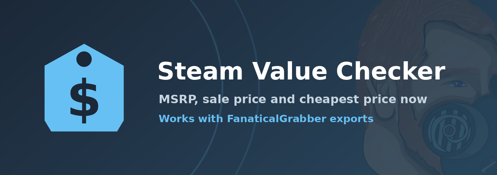

<div align="center">



# Steam Value Checker

**See what your game library is worth, and what you saved.**


</div>

---

## What it does

Send the bot a list of game titles, or upload an export from the [FanaticalGrabber](https://github.com/Jacob-Lucado/FanaticalGrabber) browser extension, and it replies with:

| Column | Meaning |
| --- | --- |
| **MSRP** | The regular price |
| **Steam** | The current Steam price |
| **Cheapest** | The lowest current price across tracked stores, with the store name |
| **All-time low** | The lowest price ever recorded (shown in the totals) |

Tell it what you paid and it works out what you saved against each of those.

Prices come from [IsThereAnyDeal](https://isthereanydeal.com).

> The bot **never needs game keys, Steam logins or cookies.** Anything that looks like a key is thrown away before any lookup. Replies are visible only to the person who ran the command.

## Commands

### `/value`

| Option | What it does |
| --- | --- |
| `titles` | Game titles separated by `;` or new lines |
| `file` | A FanaticalGrabber export: `.csv`, `.json`, `.txt` or `.md`. Only the game titles are read |
| `paid` | What you paid in total, to see savings and cost per game |
| `region` | US, UK, Germany, Canada, Australia or Brazil prices |
| `stores` | Count every tracked store (including key sites), or major stores only, for "cheapest now" |
| `sort` | As entered, name, MSRP or cheapest price |

Examples:

```
/value titles:Hades; Celeste; Hollow Knight
/value file:FanaticalGrabber_2026-10-26.csv paid:25 region:GB
```

### Wishlist and sale alerts

Import your Steam wishlist (or add games by hand) and the bot tells you when something goes on sale.

| Command | What it does |
| --- | --- |
| `/wishlist import profile:` | Reads your **public** Steam wishlist from a profile link, custom name or SteamID64. No login. Run it again to sync new games (and drop ones you removed on Steam) |
| `/wishlist add title:` | Adds one game by title, with an optional alert rule |
| `/wishlist remove game:` | Removes a game (autocompletes from your list) |
| `/wishlist view` | Your list with current prices, sales first |
| `/wishlist alert type:` | Sets when you are alerted, for one game or all: any sale, a % off or more, a price or lower, or an all-time low |
| `/wishlist check game:` | Is it a good deal right now? Price, 3-month, 1-year and all-time lows, and a plain verdict |
| `/alerts delivery` | DM (default) or the server alert channel |
| `/alerts quiethours`, `digest`, `bundles`, `freegames`, `share`, `history` | Hold alerts overnight (with your time zone), a weekly sales digest, bundle and giveaway alerts, opt in to server group alerts and the leaderboard, and your recent alerts |
| `/alerts freegames enabled:` | Get told when any game is free to claim. One message per store; several free games from the same store come with a **Claim all** button, a single game with **Claim game** |
| `/library add\|import\|view\|remove` | Games you own and what you paid. Shows what they are worth, what you saved against MSRP, and a value-over-time chart on the dashboard |
| `/serverlist add\|view\|vote\|remove` | A wishlist the whole server shares, with votes and current prices |
| `/leaderboard` | Who in the server has saved the most (percent of MSRP), for members who opted in |
| `/alertchannel group minimum:` | Post once when that many opted-in members watch the same game and it hits their alert |
| `/alerts pause`, `resume`, `region`, `stores`, `status` | Your alert settings |
| `/alertchannel set\|clear\|show` | Server admins (Manage Server): the channel used when a DM fails, or when a member opts out of DMs |
| `/mydata export\|delete` | Download or delete everything stored about you |

**How alerts are delivered**

1. **DM first.** Alerts are sent to you directly.
2. **Channel fallback.** If the DM cannot be delivered (DMs closed), the alert is posted in the server's alert channel and mentions you. If no channel is set, the alert is retried on the next check.
3. **Channel by choice.** Members who run `/alerts delivery mode:channel` skip DMs and are mentioned in the channel instead. Everyone who can see that channel can see the game name.

**How alerts avoid spam:** you are alerted once per sale. You are alerted again only if the price drops further, or after the sale ends and a new one starts. Several alerts for one person are grouped into one message.

The bot checks prices every 60 minutes by default (`CHECK_INTERVAL_MINUTES`, minimum 30, because prices are cached for 30 minutes). Each game is looked up once per region however many people watch it. Lists hold up to 200 games, and an import reads up to 150.

> Steam only shares wishlists that are **public**. Set *Game details* to Public under Profile > Edit Profile > Privacy Settings, then import.

### Giveaways (`/giveaway`)

Server owners (Manage Server, or a role set with `/giveaway setup`) can give away game keys.

- `/giveaway create title length [game] [image] [thumbnail] [color] [requirerole] [bonusrole] [pingrole] ...` opens a private form where you paste the prizes, one per line as `Name | KEY` (up to 50 keys in one giveaway). The post groups them neatly, e.g. `Hades ×2, Celeste`.
- **Artwork:** the bot finds Steam art for `game` automatically, or use your own `image` (a picture, animated GIF, or a video link: .mp4/.webm, YouTube, Vimeo, Twitch clip, Streamable, Tenor/Giphy) and a small `thumbnail` (picture or GIF). Videos play in the message itself, since Discord embeds cannot hold video. The bot never downloads media; it only links to it. `noautoimage` turns auto-art off.
- **Customise:** description, color, button text, required role, bonus entries for a role, minimum account/server age, a role to ping, and how many hours winners have to claim.
- When it ends, winners are announced with a **Claim key** button. The bot DMs the key; if DMs are closed it replies only to the winner with "Your DMs are closed, Here's your prize:".
- After delivery the winner is asked to confirm it redeemed (or report a problem). A confirmed key is wiped and the bot posts a vouch in `#vouches` (or the channel set in `/giveaway setup`).
- Unclaimed keys are redrawn to other entrants; unused keys are DMed back to the host. Also: `/giveaway end | cancel | reroll | replace | info | list`, plus a full Giveaways page on the dashboard.

Keys are encrypted (AES-256-GCM) with `KEY_ENCRYPTION_SECRET`, never appear in any public message or dashboard response, and are deleted on confirmation, cancellation or after a retention period. Set the secret in `.env` to enable giveaways; if you lose it, stored keys can't be read. Backups only contain encrypted keys.

### `/help`, `/about`, `/privacy`

Usage notes, credits and a plain-language privacy summary.

## Web dashboard

Everything the slash commands do is also in a browser, plus price-history charts, bulk actions on the wishlist, an alert history table, and an Admin page for the bot owner: the Value Checker (type titles or upload a FanaticalGrabber export, CSV download included), wishlist import, add, remove and alert rules, delivery and region settings, server alert channels for admins, and data export and delete. It has a modern look with a light and dark theme (it follows your system setting, and a button in the header switches it) and links to [FanaticalGrabber](https://github.com/Jacob-Lucado/FanaticalGrabber).

It is off unless you turn it on. To enable it:

1. In the [Developer Portal](https://discord.com/developers/applications) open **OAuth2**, copy the **Client Secret**, and under **Redirects** add `<DASHBOARD_URL>/auth/callback` (for a local test, `http://localhost:3000/auth/callback`).
2. Set `DISCORD_CLIENT_SECRET` and `DASHBOARD_URL` in `.env` (and optionally `DASHBOARD_PORT`, default 3000, and `DASHBOARD_HOST`, default `127.0.0.1`).
3. Run `npm start` and open the address.

For a public site, put a reverse proxy with HTTPS (Caddy, nginx, a Cloudflare tunnel) in front and use that `https://` address as `DASHBOARD_URL`. Cookies are marked `Secure` when the address is HTTPS. Sign-in uses the `identify` and `guilds` scopes only, and sessions are kept in memory, so a restart signs everyone out.

The dashboard runs inside the bot process and shares its database and price cache. Setting an alert channel there posts a short confirmation message, which also confirms the bot can post in that channel.

## Paid vs value

When you give an amount the bot adds:

- **Savings against four benchmarks:** MSRP, Steam now, cheapest now and all-time low, as an amount and a percentage. A negative result is shown as "extra" so overpaying is obvious.
- **Cost per game.**
- **A one-line verdict**, such as "You paid 31% of MSRP."
- **Per-game detail** when your CSV has a `Paid` column: your best deals, and games that are cheaper somewhere else right now.

A bundle price works as a single `paid` total. For per-game amounts, add a `Paid` column to the CSV before uploading. If you give both, the typed total wins.

## Results

- **15 games per page** with Previous / Next buttons, so big lists don't flood the channel.
- **A CSV download** of the full table, ready for a spreadsheet.
- Up to **100 titles** per request, with a short cooldown per user.
- Approximate title matches are marked with `~`, and games the bot can't match show as "not found".

## Setup

You need Node 22.13 or newer (the bot uses Node's built-in SQLite), a Discord application, and an IsThereAnyDeal API key.

1. **Create the Discord app** at the [Developer Portal](https://discord.com/developers/applications). Add a Bot, copy its token, and leave every Privileged Gateway Intent off. The bot only uses slash commands.
2. **Get an ITAD key** at [isthereanydeal.com/apps/my](https://isthereanydeal.com/apps/my/).
3. **Install:**
   ```bash
   git clone https://github.com/Jacob-Lucado/SteamValueChecker.git
   cd SteamValueChecker
   npm install
   ```
4. **Configure:** copy `.env.example` to `.env` and fill in `DISCORD_TOKEN`, `CLIENT_ID`, `ITAD_API_KEY`, and optionally `GUILD_ID` for instant command updates on a test server. `KEY_ENCRYPTION_SECRET` (needed for giveaways), `DATABASE_PATH`, `CHECK_INTERVAL_MINUTES` and the dashboard settings (see Web dashboard) are optional.
5. **Invite the bot** using the link on the app's **Installation** tab, with the scopes `bot` and `applications.commands` and no extra permissions.
6. **Register the commands and start:**
   ```bash
   npm run register
   npm start
   ```

The bot has to keep running to answer and to send alerts. A small VPS, Railway, Fly.io or a spare PC works. Wishlist data lives in one SQLite file (`data/steamvaluechecker.db` by default), so on a host with a temporary disk, mount a persistent volume and point `DATABASE_PATH` at it, and back the file up. There is nothing else to set up.

### Development

```bash
npm test
```

The tests cover input parsing, price summarising, the savings math, rendering limits, the ITAD and Steam clients (with a fake `fetch`), the database, alert rules and the delivery fallback (with fake Discord senders), and need no Discord token or API key.

```
src/
  index.js      Discord client and the /value flow
  commands.js   Slash command definitions
  register.js   Registers the commands with Discord
  parse.js      Reads titles from typed text or an export; drops anything key-shaped
  itad.js       IsThereAnyDeal client: lookup, fuzzy matching, prices, cache, retries
  report.js     Rows, totals and the paid-vs-value comparison
  render.js     Embeds and the CSV download
  db.js         SQLite storage for wishlists, settings and alert channels
  steam.js      Reads a public Steam wishlist
  alerts.js     Alert rules and the anti-spam logic
  notify.js     DM delivery with the server-channel fallback
  poller.js     The scheduled price check
  wishlist.js   Finding games and building the wishlist view
  handlers.js   Discord handlers for the wishlist, library, server list and alert commands
  library.js, serverlist.js, prefs.js, timeutil.js   Library tracker, shared server list, settings validation, time zones
  ops.js, backup.js, ratelimit.js   Owner alerts and health, daily database backups, dashboard rate limiting
  value.js      The /value pipeline, shared with the dashboard
  constants.js  Regions, alert types and links shared by the bot and dashboard
  dashboard/    Web dashboard: server.js (API and Discord sign-in), discord.js (REST calls)
public/         Dashboard pages: index.html, style.css, app.js
  text.js       /help, /about and /privacy copy
test/           node:test suites
branding/       Logo and banner
```

## Privacy

`/value` stores nothing. If you use wishlist alerts, the bot stores your Discord ID, wishlist, alert rules, settings, your library and what you paid (if you use it), 90 days of alert history, server list votes and (if you import) your public Steam ID, and you can export or delete it with `/mydata`. Game titles and IDs are sent to IsThereAnyDeal for prices, and user input is never written to logs. See [PRIVACY.md](PRIVACY.md) and [TERMS.md](TERMS.md).

## Known limits

- **Prices are estimates.** They are whatever IsThereAnyDeal tracked recently and can differ from a store's page.
- **"Cheapest now" can come from key-reseller sites.** Use `stores:major` to limit it to major stores.
- **Title matching can be wrong.** Fuzzy matches are marked with `~`. Check them before trusting the totals.
- **Unmatched games are left out of the totals,** while `paid` covers everything you entered. The bot notes this when it happens.
- **Steam wishlist import is untested against live Steam.** It uses Steam's `IWishlistService/GetWishlist` endpoint, which needs only a public profile. If Steam changes it, import fails with an error and manual `/wishlist add` still works.
- Alerts are best effort and run on a schedule, so a short sale can be missed.
- **Bundle, giveaway and price-history features use ITAD endpoints that have only been tested against fake responses**, like the rest of the live API calls. If ITAD changes a response, those features fail quietly and the rest keeps working.
- **Free game alerts show whatever IsThereAnyDeal lists as a giveaway.** Whether that includes every Steam free-to-keep promotion is unverified. The buttons open the store page: the bot cannot claim for you, because that needs your store login.
- The leaderboard ranks by percent saved, because members shop in different currencies.
- The ITAD endpoints and field names follow ITAD's public documentation. If ITAD changes its API, the table shows `-` for fields it can't find.

## License

[MIT](LICENSE).

## Credits

Price data by [IsThereAnyDeal](https://isthereanydeal.com). Not affiliated with or endorsed by Valve, Steam, Fanatical or IsThereAnyDeal. Steam is a trademark of Valve Corporation.

Made by [Jacob Lucado](https://x.com/twit_user69).

## Deploy on Fly.io

```bash
fly launch --no-deploy --copy-config      # pick your app name; say no to a database
fly volumes create svc_data --size 1 --region iad
fly scale count 1                         # SQLite and dashboard sessions need exactly one machine
fly secrets set DISCORD_TOKEN=... CLIENT_ID=... ITAD_API_KEY=... KEY_ENCRYPTION_SECRET=... \
  DISCORD_CLIENT_SECRET=... DASHBOARD_URL=https://YOUR-APP.fly.dev OWNER_DISCORD_ID=...
fly deploy
npm run register                          # once, from your own computer with a .env, or use GUILD_ID for a test server
```

Add `https://YOUR-APP.fly.dev/auth/callback` as a redirect under OAuth2 in the Discord Developer Portal.
